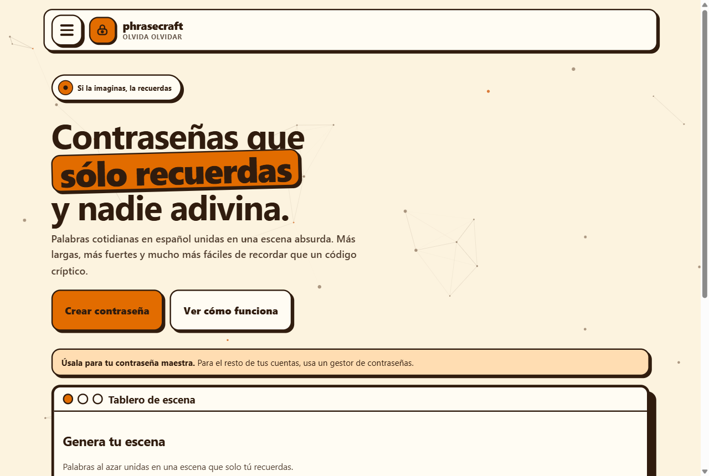
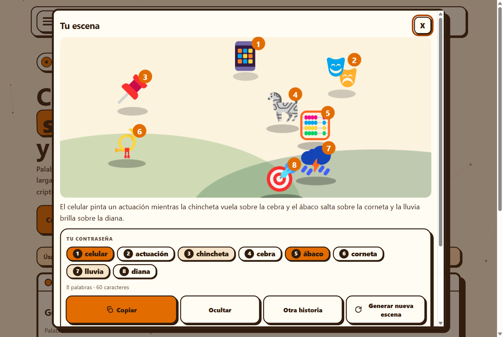

# phrasecraft

**Contraseñas maestras que sí recuerdas.** Una escena absurda para recordar **una sola** contraseña de verdad: tu maestra del gestor, tu desbloqueo, tu disco. Con un clic generas varias palabras concretas, las ves como iconos numerados en una escena animada unidos por una frase absurda, y las practicas en minutos.

**Pruébala:** https://phrasecraft.pages.dev

*Así empieza todo: un titular, un tablero y un botón.*

## Úsala

1. **Genera** tu escena en la [página principal](https://phrasecraft.pages.dev).
2. **Practica** en 5 etapas guiadas en [/practicar](https://phrasecraft.pages.dev/practicar).
3. **Repasa** a 1, 3 y 7 días; suma tu granito en [/estudio](https://phrasecraft.pages.dev/estudio).

Úsala para tu contraseña maestra. Para el resto de tus cuentas, usa un gestor de contraseñas.

*Tu escena: iconos numerados, historia absurda y tu contraseña en chips.*

## Características

- Escena animada + frase absurda: tres anclas de memoria en vez de una lista.
- Práctica en 5 etapas solo en memoria, con recordatorios de repaso.
- PWA instalable que funciona sin conexión.
- Sin cuentas: entras y la usas. Código abierto (MIT).

## Desarrollo

Astro 5 + Svelte 5, CSS propio con tokens y cero dependencias de terceros en el cliente.

- `npm run dev` / `npm run build` / `npm run preview`
- `npm run check`: lint + tipos + tests + wordlist (CI en verde requerido para merge)

## Licencia

MIT — ver [LICENSE](LICENSE). Iconos Fluent Emoji (© Microsoft, MIT).
